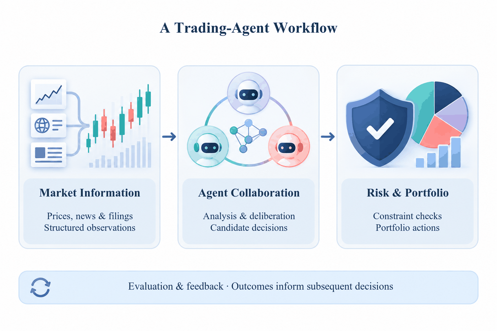

# Ethan's Skills

Agent skills I use for real work. Plain Markdown, no framework, and easy to cut down to what you need.

They are small on purpose: a skill is a checklist a good colleague would hand you, not a process that takes over the keyboard. Adapt them, fork them, delete the parts you disagree with.



*Output of [`imagegen-to-drawio`](./skills/visuals/imagegen-to-drawio/SKILL.md): the module plate is generated artwork, while the heading, card labels, and arrows are native, movable draw.io objects.*

## Install

Pick one route per agent. Installing two gives you every skill twice.

<details>
<summary><strong>Claude Code</strong></summary>

```bash
claude plugin marketplace add XiaYiHann/ethan-skill
claude plugin install ethan-skill@ethan
```

Updates itself by default.

</details>

<details>
<summary><strong>Codex</strong></summary>

```bash
codex plugin marketplace add XiaYiHann/ethan-skill
codex plugin add ethan-skill@ethan
```

</details>

<details>
<summary><strong>Any Agent Skills compatible agent</strong> (editable files)</summary>

```bash
npx skills@latest add XiaYiHann/ethan-skill -a <agent>   # claude, codex, cursor, pi, amp, devin, ...
```

This copies editable files into your project. Update them with `npx skills@latest update`.

</details>

<details>
<summary><strong>Manual install</strong></summary>

Copy the skill folder into the directory your agent reads, for example:

```bash
git clone https://github.com/XiaYiHann/ethan-skill.git
ln -s "$PWD/ethan-skill/skills/visuals/imagegen-to-drawio" ~/.agents/skills/imagegen-to-drawio
```

Or clone once and run `scripts/link-skills.sh`, which symlinks every skill in this repo into `~/.claude/skills` and `~/.agents/skills` so a `git pull` keeps them current.

</details>

## Skills

### Research

**Model-invoked**: you can type them, and the agent can also reach for them when the task fits.

- **[rank-my-paper](./skills/research/rank-my-paper/SKILL.md)**: Compare a finished manuscript against up to seven officially accepted same-domain peers, reviewed independently under a shared rubric, and return an evidence-bound ranking with revision priorities.
- **[darpa](./skills/research/darpa/SKILL.md)**: Put the current work through the Heilmeier Catechism: eight hard questions on value, risk, cost, and milestones, ending in falsifiable mid-term and final exams. Written in Chinese.

### Visuals

**Model-invoked**: you can type them, and the agent can also reach for them when the task fits.

- **[imagegen-to-drawio](./skills/visuals/imagegen-to-drawio/SKILL.md)**: Build an editable draw.io framework figure from per-module, text-free ImageGen artwork, with native labels, bound connectors, and a verified export.

## Repo layout

```text
skills/<bucket>/<skill>/    the skills themselves, one folder each
assets/                     images the READMEs reference
.claude-plugin/             plugin and marketplace manifests (what installers read)
scripts/                    validate_skills.py, link-skills.sh, list-skills.sh
```

Each skill sits in a topical bucket: `research/`, `visuals/`, and later `engineering/` or `productivity/`. Those buckets ship in the plugin. `in-progress/`, `misc/`, and `deprecated/` hold skills by maturity instead, and never ship. [AGENTS.md](./AGENTS.md) has the full rules.

## Adding or changing a skill

1. Edit `skills/<bucket>/<skill>/SKILL.md` (plus any `references/*.md` it links to).
2. Update the skill list in the top-level `README.md`, the bucket `README.md`, and `.claude-plugin/plugin.json`.
3. Run `python3 scripts/validate_skills.py`. It fails on drift between the manifests, the READMEs, and the files on disk.
4. Add a `CHANGELOG.md` entry and bump `version` in `.claude-plugin/plugin.json`.

## License

MIT. See [LICENSE](./LICENSE).
